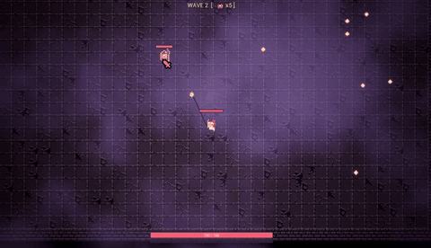

# Project Riot (working title)

A top-down arena game in Unreal Engine 5.8, built with C++ and Paper2D, in the style of Brotato.

This is the first playable milestone: WASD movement, a camera that eases after the player and stops at the arena walls, and looping music. Enemies and combat are next.

- **Play it (Windows download):** <ITCH_URL>
- **Why it's built the way it is:** [DECISIONS.md](DECISIONS.md), my running log of design decisions

## What's in the code

- `AArenaPlayerPawn`: Enhanced Input WASD movement. Diagonals are clamped so they aren't faster, and speed is frame-rate independent. The player is clamped inside the arena and has an overlap-only collision sphere, ready for enemy hits. A custom orthographic camera eases after the player and stops before it would show past the arena edge.
- `AArenaGameMode`: plays the music as a looping 2D sound.
- C++ holds the behavior. Blueprint subclasses only plug in assets (sprite, input, music), so no asset paths are hardcoded in code.

## How it's built

This is my first Unreal project; my earlier engine work is in Godot. It's built AI-assisted: Claude lays out options for each feature, I make the design calls, and I audit the code. The details are in [DECISIONS.md](DECISIONS.md) entry 003.

## Credits

- Music: "chiptune police loop" by obscure music (CC0), from [OpenGameArt](https://opengameart.org/content/chiptune-police-loop)
- Placeholder art: made by Claude (Anthropic), to be replaced with my own
